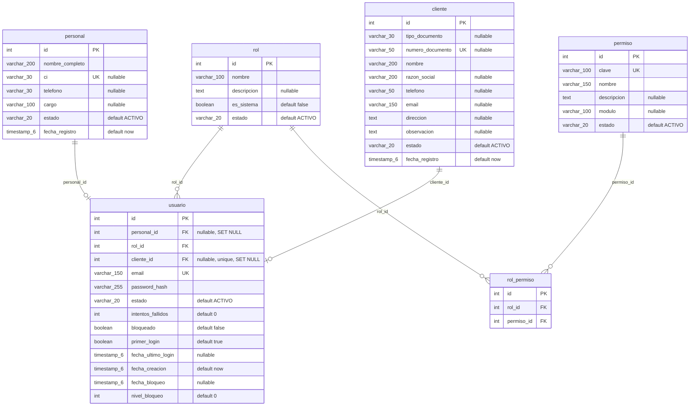
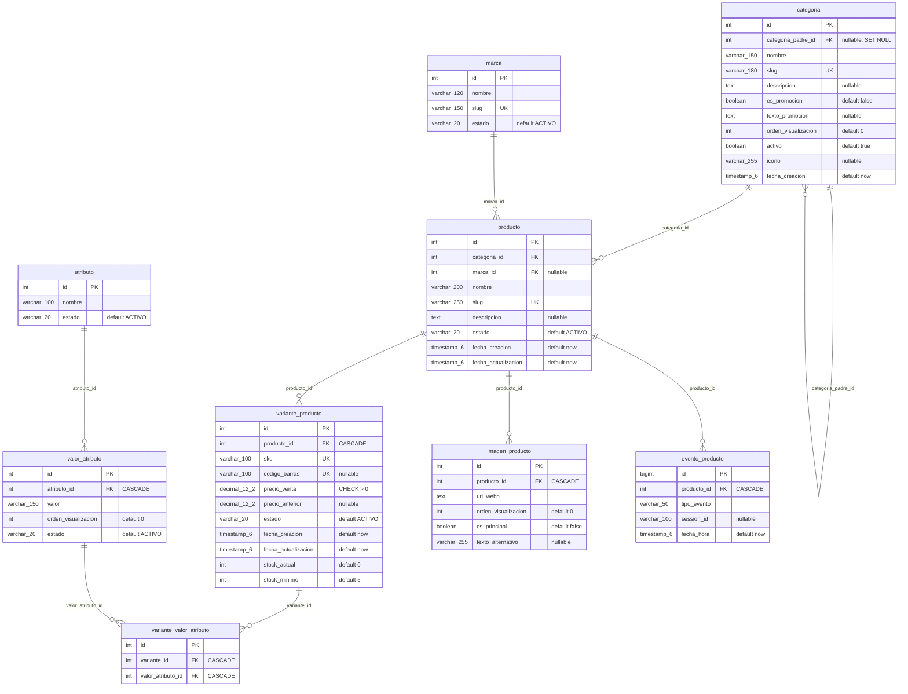
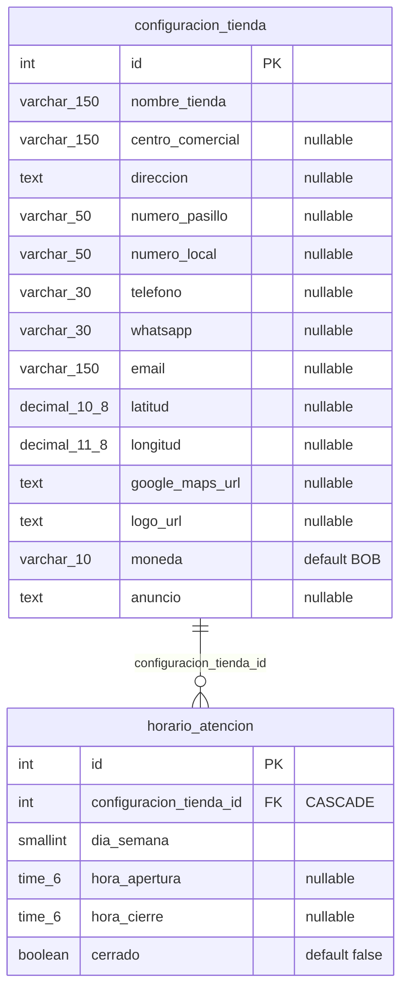
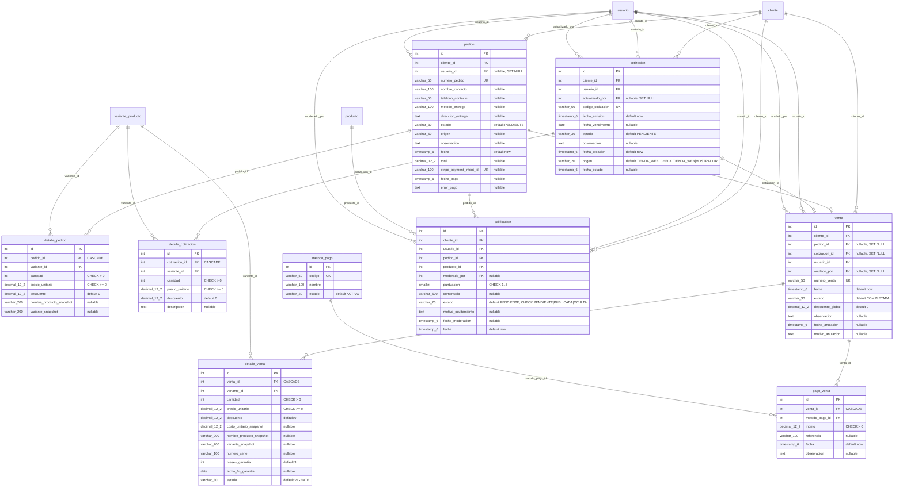
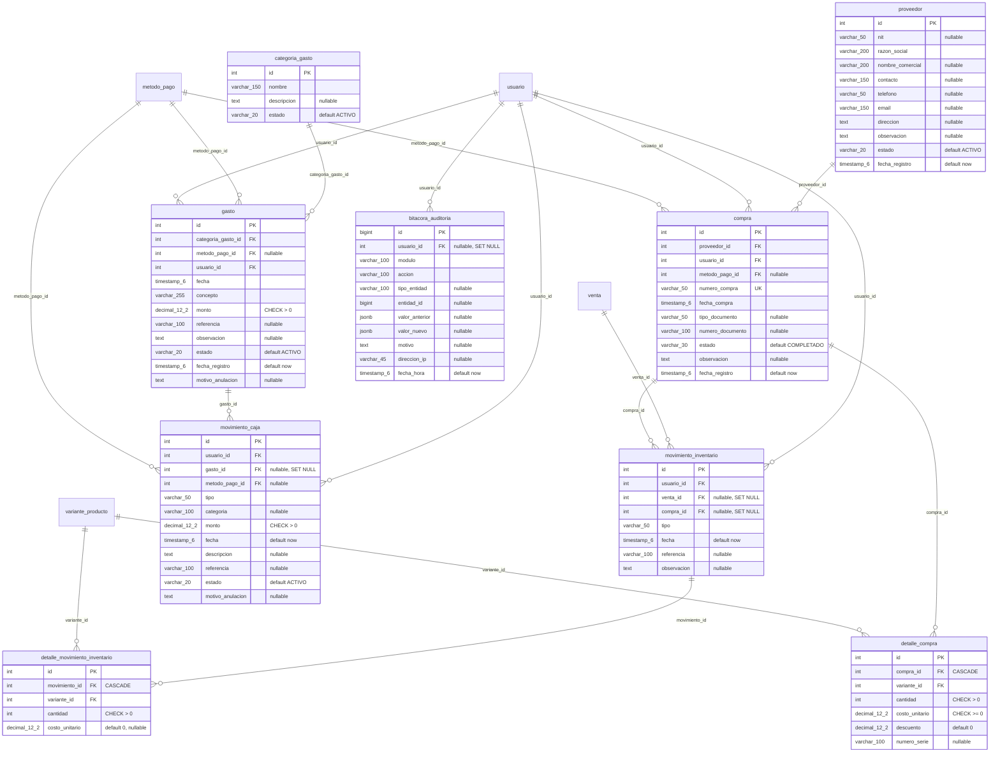
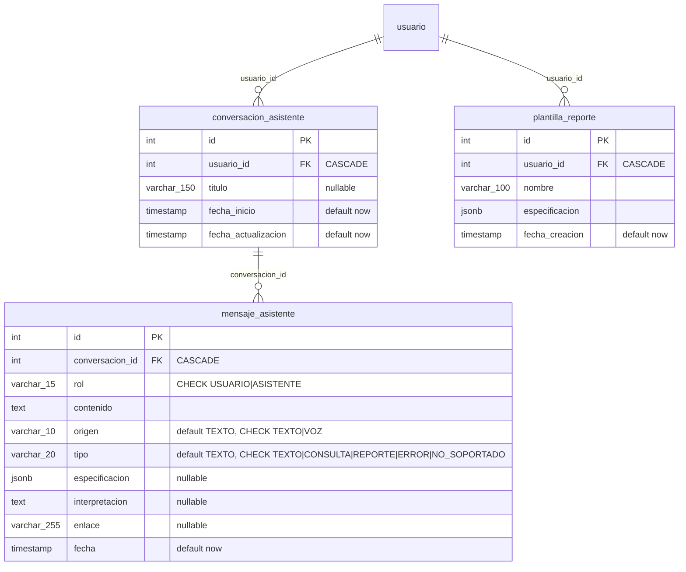

# Diagrama de la base de datos

Esquema de dominio según las migraciones actuales (PostgreSQL). Las tablas de infraestructura de Laravel (`users`, `sessions`, `password_reset_tokens`, `cache`, `jobs`, `passkeys`) no forman parte del modelo de la tienda: la autenticación usa `usuario`.

Cardinalidad: `1` obligatorio, `0..1` opcional, `1..N` varios.

## Relaciones (vista general)

```mermaid
erDiagram
    rol ||--o{ usuario : tiene
    rol ||--o{ rol_permiso : otorga
    permiso ||--o{ rol_permiso : asignado_en
    personal ||--o| usuario : cuenta
    cliente ||--o| usuario : cuenta_web
    cliente ||--o{ pedido : realiza
    cliente ||--o{ cotizacion : recibe
    cliente ||--o{ venta : compra
    cliente ||--o{ calificacion : emite

    usuario ||--o{ cotizacion : emite
    usuario ||--o{ venta : registra
    usuario ||--o{ compra : registra
    usuario ||--o{ pedido : titula
    usuario ||--o{ gasto : registra
    usuario ||--o{ movimiento_caja : registra
    usuario ||--o{ movimiento_inventario : registra
    usuario ||--o{ bitacora_auditoria : deja
    usuario ||--o{ conversacion_asistente : habla
    usuario ||--o{ plantilla_reporte : guarda
    usuario ||--o{ calificacion : emite
    usuario ||--o{ cotizacion : actualiza_estado
    usuario ||--o{ venta : anula
    usuario ||--o{ calificacion : modera

    categoria ||--o{ categoria : padre
    categoria ||--o{ producto : agrupa
    marca ||--o{ producto : marca
    producto ||--o{ variante_producto : variantes
    producto ||--o{ imagen_producto : imagenes
    producto ||--o{ evento_producto : eventos
    producto ||--o{ calificacion : recibe
    atributo ||--o{ valor_atributo : valores
    variante_producto ||--o{ variante_valor_atributo : usa
    valor_atributo ||--o{ variante_valor_atributo : aplicado_a
    variante_producto ||--o{ detalle_pedido : lineas
    variante_producto ||--o{ detalle_cotizacion : lineas
    variante_producto ||--o{ detalle_venta : lineas
    variante_producto ||--o{ detalle_compra : lineas
    variante_producto ||--o{ detalle_movimiento_inventario : lineas

    configuracion_tienda ||--o{ horario_atencion : horarios

    pedido ||--o{ detalle_pedido : items
    pedido ||--o| venta : convierte
    pedido ||--o{ calificacion : califica

    cotizacion ||--o{ detalle_cotizacion : items
    cotizacion ||--o| venta : convierte

    venta ||--o{ detalle_venta : items
    venta ||--o{ pago_venta : pagos
    venta ||--o{ movimiento_inventario : kardex
    metodo_pago ||--o{ pago_venta : medio
    metodo_pago ||--o{ compra : medio
    metodo_pago ||--o{ gasto : medio
    metodo_pago ||--o{ movimiento_caja : medio

    proveedor ||--o{ compra : abastece
    compra ||--o{ detalle_compra : items
    compra ||--o{ movimiento_inventario : kardex
    movimiento_inventario ||--o{ detalle_movimiento_inventario : items

    categoria_gasto ||--o{ gasto : clasifica
    gasto ||--o{ movimiento_caja : asiento

    conversacion_asistente ||--o{ mensaje_asistente : mensajes
```

## Seguridad y personas

Único: `rol_permiso (rol_id, permiso_id)`.

## Catálogo e inventario

Único: `variante_valor_atributo (variante_id, valor_atributo_id)`.

## Configuración de la tienda

## Pedidos, cotizaciones y ventas

Único: `calificacion (pedido_id, producto_id)`. Índice: `calificacion (producto_id, estado)`, `cotizacion (estado)`.

## Compras, kardex, caja y bitácora

## Asistente virtual

Único: `plantilla_reporte (usuario_id, nombre)`.
